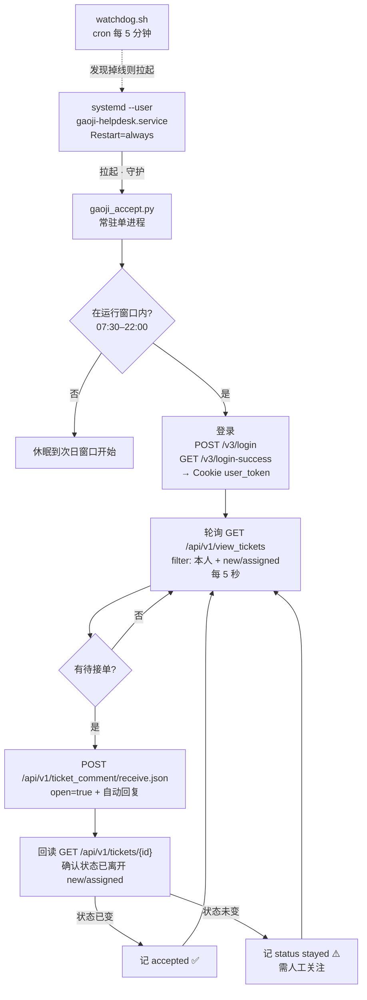
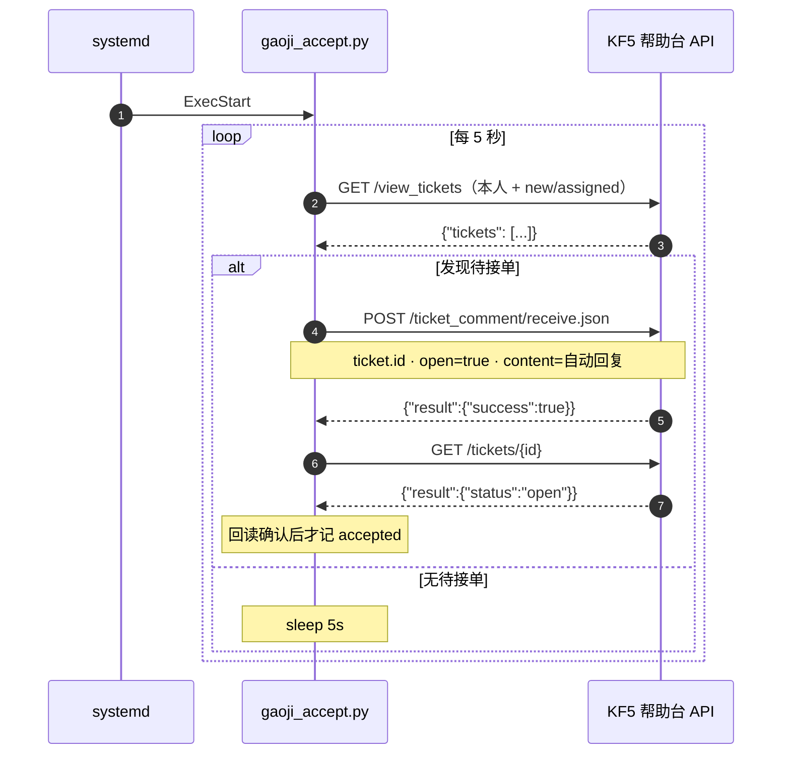

# KF5 帮助台自动接单 · gaoji-helpdesk

> 纯 HTTP、零浏览器的帮助台自动接单守护进程。
> 每 5 秒轮询"本人待接单"，发现工单立即接单并附上回复 —— **实测中位耗时 1 秒**。


> ⚠️ **本仓库已脱敏**：接口域名、`provider_id`、`user_id`、日志样例均为占位符。
> 部署时请在 `secrets.env` 填入你自己的值。

---

## 数据速览

| 指标 | 实测值 |
|---|---|
| 累计自动接单 | **1529 张**（日志覆盖 4.5 个月） |
| 单张工单耗时 | **中位 1 秒**（均值 1.3s，最大 6s） |
| 常驻内存 | **31 MB** RSS |
| 代码规模 | 主程序 **247 行**，含工具与测试共 542 行 |
| 单元测试 | **15 项全绿** |
| 第三方依赖 | 只有 `requests` |

---

## 目录

- [为什么重写](#为什么重写)
- [架构](#架构)
- [一次接单的完整时序](#一次接单的完整时序)
- [核心特性](#核心特性)
- [四个关键设计](#四个关键设计)
- [快速开始](#快速开始)
- [配置项](#配置项)
- [日常使用](#日常使用)
- [常驻与开机自启](#常驻与开机自启)
- [⚠️ 静默停摆与看门狗](#️-静默停摆与看门狗)
- [排错手册](#排错手册)
- [安全说明](#安全说明)
- [目录结构](#目录结构)
- [版本记录](#版本记录)

---

## 为什么重写

最初的方案是 **Playwright 驱动浏览器**操作帮助台页面。它在真实环境里极不稳定：

| 问题 | 现象 |
|------|------|
| 目标是重型 Angular SPA | 首屏加载 10–60 秒，`pre-loading` 遮罩长时间不消失 |
| DOM 定位脆弱 | 侧边栏、表格行靠 `li.ng-scope.cursorhand` 这类**编译产物类名**定位，随版本变化 |
| 轮询被阻塞 | 单次页面操作占用数十秒，期间完全错过新工单 |
| 资源开销 | 常驻一个 Chromium 进程，300MB+ 内存 |
| 结果 | **漏单**，且故障时无法自愈 |

**转折点**：与其猜接口，不如**抓真实请求**。用 Playwright 的 `page.on("request")` 拦截浏览器实际发出的接单请求，一次性拿到真实端点：

```
POST /api/v1/ticket_comment/receive.json
```

在此之前试过的 `PUT /ticket_comment/open`、`grab.json` 等猜测端点，全部是**假成功**（返回 `status:0` 但工单状态没变）。

> **教训：真实端点必须从浏览器实际流量里逆向，不能凭直觉猜。**

拿到端点后，整件事变成 247 行纯 HTTP 代码：

| | 浏览器方案 | 本项目 |
|---|---|---|
| 单张工单 | 数十秒 | **1 秒（实测中位）** |
| 常驻内存 | 300 MB+ | **31 MB** |
| 依赖 | Chromium + Playwright | **`requests`** |
| DOM 变化 | 随时失效 | 不受影响 |
| 故障自愈 | 无 | systemd + 看门狗 |

---

## 架构



**三层容错**：

1. `Restart=always` —— 进程崩溃自动重启
2. 主循环 `try/except` 自愈 —— 会话过期、网络抖动时重建客户端，**异常绝不冒泡到退出**
3. `watchdog.sh` —— 补上 systemd 管不到的"被人为 stop"场景

---

## 一次接单的完整时序



---

## 核心特性

- ⚡ **快** — 纯 HTTP 接单，实测中位 **1 秒**
- 🪶 **轻** — 唯一依赖 `requests`，常驻 **31 MB**，无 Chromium
- 🎯 **精准** — 只处理 filter 限定的 **本人待接单**（`engineer.id=${current_engineer_id}`），**绝不触碰公共抢单池**
- ✅ **可验证** — 接单后回读状态，确认真的离开 `new`/`assigned` 才记成功
- 🕐 **自带运行窗口** — 默认 07:30–22:00，窗口外自动休眠
- 🔁 **自愈** — 网络抖动 / 会话过期时重建客户端重试，不会整体退出
- 💬 **自动回复** — 接单同时发送话术，文案可配置
- 🔐 **凭据外置** — 账号密码只存在于 600 权限的 `secrets.env`，代码零硬编码
- 🧪 **有测试** — 15 项单元测试，不发真实请求

---

## 四个关键设计

### 1. `engineer.id` 用服务端占位符，而不是客户端过滤

```json
{"$eq": {"engineer.id": "${current_engineer_id}"}}
```

`${current_engineer_id}` **由服务端替换**为当前登录者。结果天然只包含"我的待接单"——
这不是靠客户端 `if` 判断，而是**查询本身就不可能返回别人的单**。

> 业务硬约束"不碰公共池"因此有了技术保证，而不是依赖代码写对。

### 2. `_fields` 有黑名单，失败是静默的

| `_fields` | 结果 |
|-----------|------|
| `id,status,no,subject,requester.name` | ✅ 正常 |
| 含 `engineer` | ❌ **返回 0 条**（HTTP 200，不报错） |
| 含裸 `requester` | ❌ 返回 0 条 |

**这类失败最危险**：状态码正常、结构正常，只是列表为空。接不到单时第一个查它。

### 3. `_token` 必须是 `user_token`，不是 `sid`

用 `sid` 调用返回 `status:3002`。`user_token` 在登录后由 `/v3/login-success` 写入 Cookie ——
**登录接口本身不返回 token**，必须跟随这一步。

### 4. 回读验证，不信任 `success:true`

接口返回成功不等于状态变了（历史上踩过"假成功"端点）。
所以接单后必查 `GET /tickets/{id}`，只有状态真的变化才记成功。

> 这是整套系统里最便宜也最值钱的一道闸：**两行代码，换掉一类静默错误**。

---

## 快速开始

### 前置要求

- Linux（systemd 用户实例可用）
- Python 3.11+
- 一个提供上述接口的 KF5 帮助台，以及可用账号
  > 本项目是针对该类系统接口的逆向实现，**不是通用协议**。换系统需要自行调整端点与字段。

### 一句话安装

```bash
git clone https://github.com/miglore/gaoji-helpdesk.git
cd gaoji-helpdesk
./install.sh
```

`install.sh` 会：建 venv → 装 `requests` → 生成 `secrets.env`（600 权限）→ 注册 systemd 用户服务 → 链接 `gaoji` 管理命令。

### 填入凭据（交互向导）

```bash
./setup.sh
```

向导只问 4 项：帮助台地址、provider_id、账号、密码。它会**真的登录验证一次**，
并**自动探测你的 user_id** 后写入 `secrets.env`（权限 600）—— 不需要手查任何 ID。

> 如果你已经配置过，`./setup.sh` 会把现有值当默认值，直接回车即可沿用 ——
> 于是换人使用时，**只需要输自己的账号和密码**。

### 给同事使用

同事也有同一个帮助台时，全流程只要三步：

```bash
git clone https://github.com/miglore/gaoji-helpdesk.git && cd gaoji-helpdesk
./setup.sh           # 输地址、provider_id、自己的账号、自己的密码
./install.sh --start # 装依赖并启动
```

`user_id` 由程序第一次登录后自动探测，**同事不用知道也不用填**。
请把「帮助台地址」和「provider_id」私下告诉同事（仓库里是占位符）。

### 启动并体检

```bash
gaoji start
gaoji check
```

`gaoji check` 正常输出（**日志样例已脱敏**）：

```
服务状态 : active
重启次数 : 0
进程 PID : 79048
--- 最近 2 条接单日志 ---
[2026-10-16 16:46:41] pure-api acceptor started
--- 到帮助台的真实连接（有 ESTAB 才是真在轮询）---
ESTAB 0 0 192.0.2.10:52254 203.0.113.20:443 users:(("python3.12",pid=79048,fd=3))
```

> **看门道**：`active` 只说明进程活着；**必须有 `ESTAB` 连接**才能证明它真的在和帮助台通信。

---

## 配置项

全部通过环境变量注入，优先级：`secrets.env` → 系统环境。

| 变量 | 必填 | 默认值 | 说明 |
|------|:----:|--------|------|
| `GAOJI_USERNAME` | ✅ | — | 帮助台登录账号 |
| `GAOJI_PASSWORD` | ✅ | — | 登录密码 |
| `GAOJI_PROVIDER_ID` | ✅ | — | 服务商 ID |
| `GAOJI_USER_ID` | | 自动探测 | 工程师 user ID，写入接单请求的 `user.id`；**留空则登录后自动获取** |
| `GAOJI_BASE_URL` | ✅ | `https://helpdesk.example.com` | 接口基址（**改成你自己的**） |
| `GAOJI_POLL_SECONDS` | | `5` | 轮询间隔（秒） |
| `GAOJI_WINDOW_START` | | `07:30` | 运行窗口开始 |
| `GAOJI_WINDOW_END` | | `22:00` | 运行窗口结束 |
| `GAOJI_LOG_FILE` | | `<项目目录>/accept.log` | 日志路径 |
| `GAOJI_AUTO_REPLY` | | 见下 | 接单时发送的自动回复 |

**默认自动回复**（中性示例，请换成你自己的话术）：

```
您好，请描述一下具体情况并附上截图，我们尽快为您处理；如需远程协助，请提供远程工具识别码和验证码。感谢您的配合！
```

**配置缺失时的行为**：进程以退出码 `78`（`EX_CONFIG`）退出并写日志。systemd 单元配了
`RestartPreventExitStatus=78`，所以**不会**陷入无限重启风暴。

---

## 日常使用

```
gaoji start      启动接单服务（含开机自启）
gaoji stop       停止服务（并取消开机自启 = 真暂停）
gaoji restart    重启服务
gaoji status     查看 systemd 状态
gaoji check      体检：状态 / 重启次数 / 最近日志 / 真实网络连接
gaoji logs       实时跟踪 journal 日志
gaoji tail       查看最近 30 行接单日志
```

**`stop` 与"临时暂停"的区别**

| 命令 | 效果 | 重启机器后 |
|------|------|-----------|
| `gaoji stop` | `stop` + `disable` | ❌ 不会自动恢复（真暂停） |
| `systemctl --user stop gaoji-helpdesk` | 只 `stop`，仍 `enabled` | ✅ 会自动恢复 |

**查看接单日志**（样例已脱敏）

```bash
tail -f accept.log
# [2026-10-16 16:18:28] accepting #100234567 示例门店：收银机无法启动，麻烦处理一下，谢谢
# [2026-10-16 16:18:29] accepted #100234567: assigned -> open
```

| 日志 | 含义 |
|------|------|
| `accepting` | 发现并开始处理 |
| `accepted ... -> open` | 接单成功，状态已变更 |
| `status stayed` | API 说成功但状态没变，**需关注** |

---

## 常驻与开机自启

```bash
# 1. 注册开机自启
systemctl --user enable gaoji-helpdesk

# 2. 关键：让服务在 SSH 断开后继续存活
sudo loginctl enable-linger $USER
```

> ⚠️ 不做 `enable-linger`：systemd 用户实例随最后一个登录会话退出而结束，服务跟着被杀 ——
> 表现为"随机掉线"，实际是会话生命周期问题。

---

## ⚠️ 静默停摆与看门狗

**这是本项目最容易踩的坑，务必读。**

`Restart=always` 只在进程**异常退出**（崩溃、被 OOM kill）时生效。一旦有人执行：

```bash
systemctl --user stop gaoji-helpdesk
```

systemd 认为这是用户的明确意图，**不会自动拉起**。此时服务 `inactive (dead)`，而单元依然
`enabled` —— 表面毫无异样，`accept.log` 停在最后一次接单，**服务时段内静默漏单**。

> **真实事故**：一次外部维护中服务被 `stop`，静默停摆 **28 分钟**（16:18 → 16:46），
> 期间所有工单全部漏接，无人察觉。事后才发现：`Restart=always` 压根没被触发过。

### 看门狗补上这一层

```bash
# crontab -e，每 5 分钟检查一次
*/5 * * * * /home/ubuntu/gaoji-helpdesk/watchdog.sh >> /home/ubuntu/gaoji-helpdesk/watchdog.log 2>&1
```

`watchdog.sh` 只在**运行窗口内**且服务不 `active` 时才拉起，并记录：

```
[2026-10-16 16:46:40] ⚠️ 服务状态=inactive，正在拉起…
[2026-10-16 16:46:43] ✅ 已恢复
```

### 维护后必做

```bash
gaoji check
```

---

## 排错手册

| 症状 | 原因 | 处理 |
|------|------|------|
| 进程在跑但从不接单 | `_fields` 含 `engineer`/`requester`，接口静默返回 0 条 | 保持 `_fields=id,status,no,subject,requester.name` |
| 日志 `status:3002` | 用了 `sid` 而不是 `user_token` | 确认走了 `/v3/login-success` 再取 Cookie |
| `login returned no user_token` | 账号/密码/`provider_id` 不对，或触发验证码 | 浏览器手工登录核对；检查 `secrets.env` |
| 日志 `accepted` 但工单没变 | 调到了"假成功"端点 | 必须是 `POST /api/v1/ticket_comment/receive.json` |
| 服务莫名消失 | 被外部 `stop` 了 | 装看门狗（见上节） |
| SSH 断开后服务没了 | 没开 `linger` | `sudo loginctl enable-linger $USER` |
| 退出码 78 | 配置缺失 | 填 `secrets.env` 后 `gaoji restart` |
| 改了 `GAOJI_AUTO_REPLY` 不生效 | 进程没重启，仍用旧配置 | `gaoji restart` |

---

## 安全说明

1. **凭据只存在于 `secrets.env`**（`chmod 600`），已被 `.gitignore` 排除。
2. **不要把真实账号密码提交到 Git。** 即使仓库 private，历史也会长期保留，且会被 clone、fork、缓存。
3. 需要私有备份时：**代码进仓库，凭据单独备份**（密码管理器 / 加密卷）。
4. 若误提交了凭据：立即改密码，再用 `git filter-repo` 清理历史并强推。
5. **本仓库已脱敏**：接口地址为 `helpdesk.example.com`，`provider_id` / `user_id` 为示例值，
   账号、密码、真实工单号、门店名、内网 IP 均未进入仓库（**含全部 git 历史**）。
6. 仅限授权人员在内部环境使用，请遵守所在组织的 IT 规范。

---

## 目录结构

```
gaoji-helpdesk/
├── gaoji_accept.py             # 核心：纯 API 接单守护进程（247 行）
├── gaoji                       # 管理命令 CLI
├── install.sh                  # 一键安装（venv + systemd + 软链）
├── watchdog.sh                 # 看门狗：防止静默停摆
├── gaoji-helpdesk.service      # systemd 用户单元（凭据走 EnvironmentFile）
├── secrets.env.example         # 凭据模板（复制为 secrets.env）
├── requirements.txt            # requests
├── tests/
│   └── test_gaoji_accept.py    # 15 项单元测试（不发真实请求）
├── docs/
│   └── ARCHITECTURE.md         # 实现思路 / API 逆向细节 / 陷阱清单
├── LICENSE                     # MIT
└── README.md
```

---

## 版本记录

| 日期 | 变更 |
|---|---|
| 2026-10 | **工程化重构**：凭据外置、全部参数可配、15 项测试、看门狗、完整文档 |
| 更早 | 从浏览器自动化（Playwright）重写为纯 API 方案 —— 详见 [`docs/ARCHITECTURE.md`](docs/ARCHITECTURE.md) |

---

## 免责声明

本项目为内部运维自动化工具，用于减少人工接单延迟。使用者需自行确保：
账号授权合规、自动回复内容经业务方确认、符合所在组织的信息安全规定。
作者不对因使用本工具产生的业务后果负责。

MIT License © 2026 miglore
